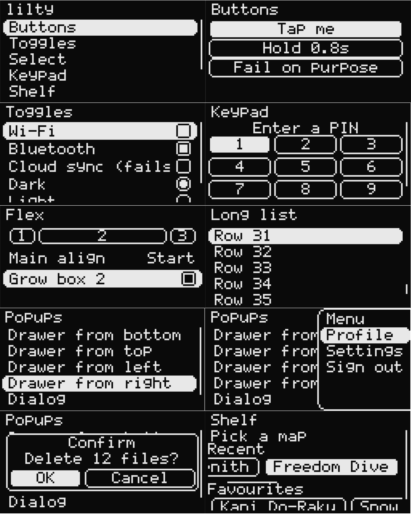

# lilty (C++)

<div align="center">

[](https://registry.platformio.org/libraries/zupub/lilty)


[](https://github.com/zupub/lilty/actions/workflows/build.yml)


</div>

<p align="center">
  
</p>

<p align="center">
  <strong>中文 | <a href="README.md">English</a></strong>
</p>

128×64 单色屏上的小型 GUI 框架，是 **[lilt](https://github.com/chhongzh/lilt)**（Go / TinyGo
版，`lilt-0.2.0`，作者 [chhongzh](https://github.com/chhongzh)）的 C++ 重写。

`lilty` 这个名字只表示"lilt 的 C++ 重写版"：结构、手感、API 都照原版来，把 Go 的接口换成
`Node` 基类、把通道换成同步回调、把 GC 换成显式 `delete`。定位不变：**面向方向键与
旋钮**、**所有动画都由弹簧驱动**、**页面和弹窗共用一个层栈**。

- 逻辑坐标以 128×64 为基准，按 `min(w/128, h/64) × zoom` 缩放到实际像素
- 按下只给反馈，松手才触发（`KeyEvent::fires()`）
- 全局单一光标，移动时朝目标拉长、落后时收拢，越不过的边会被橡皮筋拉住
- 焦点导航用 Android FocusFinder 的打分（`13·major² + minor²`），不依赖 DOM 顺序
- 旋钮只有"上一格 / 下一格"，横排容器里自动当左右用
- 无 RTTI、无异常、无 `std::vector`/`std::string`，节点全部显式 `new`/`delete`

## 目录

分成三段：`core` 不碰硬件，`display` 和 `input` 是每块板子各写一份的后端。

```
lilty/
├── library.json  library.properties      PlatformIO / Arduino IDE 的元数据
├── platformio.ini                        只给 `pio test` 用，见「测试」
├── README.md  README.zh-CN.md  CHANGELOG.md  LICENSE
├── assets/                              README 里用的截图
├── src/
│   ├── lilty.h  lilty.cpp       begin() / loop() 粘合层（零硬件依赖，见下）
│   ├── core/                    零硬件依赖：换到桌面端只要换一个 Screen
│   │   ├── gfx.h  gfx.cpp       Color / Rect / Screen / Canvas
│   │   ├── font5x7.cpp          5×7 ASCII 点阵（数据在 flash，不占 RAM）
│   │   ├── anim.h  anim.cpp     Spring / Value / 全局调度表
│   │   ├── ui.h                 Node / Flex / Stack / Grid / 选项工厂 / 层栈 / 输入
│   │   ├── ui_core.cpp          Node、布局、Flex/Stack/Grid、选项实现
│   │   ├── ui_runtime.cpp       层栈、焦点导航、光标、每帧 frame()
│   │   └── widget.h  widget.cpp Label / List / Button / CheckBox / Radio /
│   │                            Select / Drawer / Dialog / Toast
│   ├── display/                 显示后端：实现 gfx::Screen
│   │   ├── sh1106_i2c.h  .cpp   SH1106 128×64 I2C（Arduino）
│   │   └── gfx_sdl.h  .cpp      128×64 画进 SDL2 窗口（桌面端）
│   └── input/                   输入后端：往 lilty::ui::emit 里喂 Key
│       ├── rotary.h  .cpp       旋转编码器 + 两个按键（Arduino）
│       └── sdl_input.h  .cpp    键盘，驱动 SDL2 窗口（桌面端）
├── examples/                    每个子目录都是独立的 PlatformIO 工程
│   ├── esp32s3-sh1106-rotary/   参考实现：ESP32-S3 + SH1106 + 旋钮，八个页面
│   ├── minimal/                 最小骨架：一屏一列表，移植新硬件从它抄
│   └── pc-sdl/                  不接板子：同样的界面跑在 SDL2 窗口里
├── test/test_core/              桌面端单测（自带的 mock Screen）
└── .github/workflows/build.yml  每次 push 编译三个 example + 跑单测
```

`lilty.cpp` 里只有一处和平台相关：取微秒时间戳。Arduino 下用 `micros()`，其它平台用
`std::chrono::steady_clock`。所以连帧循环都能在 PC 上跑，`core/` 是真正可移植的。

边界只有两条，移植就是照这两条补文件：

| 层 | 只依赖 | 换硬件时你要做的 |
| --- | --- | --- |
| `core/` | C++ 标准库、`<stdint.h>` | 什么都不用动 |
| `display/` | `core/gfx.h` + 你的总线库 | 新写一个 `Screen` 子类 |
| `input/` | `core/ui.h` + 你的 GPIO 库 | 新写一个 `poll(dt)` 往 `emit()` 里推键 |

## 安装

**PlatformIO**（推荐）—— 库已在
[PlatformIO Registry](https://registry.platformio.org/libraries/zupub/lilty) 上：

```ini
[env:esp32s3]
platform = espressif32
board = esp32-s3-devkitc-1
framework = arduino
lib_deps = lilty
```

首次 `pio run` 会自动下载。需要可复现的构建就钉住版本：`lib_deps = lilty@^0.1.0`
接受任意 0.1.x，`lilty@0.1.0` 则完全锁定那一个版本。

本地开发时直接指回源码，改库不用重装：

```ini
lib_deps = symlink://path/to/lilty
```

不想用 `lib_deps`，也可以把 `-I lilty/src` 加进 `build_flags`，让编译器直接看到源码。

**Arduino IDE** —— 从 GitHub 下载 zip，`Sketch > Include Library > Add .ZIP Library`，
然后 `#include <lilty.h>`。`library.properties` 已经写好；等 Arduino 库索引收录后
库管理器就能直接搜到，在那之前走 zip 这条路。

## 移植到别的硬件

### 显示后端

实现 `lilty::gfx::Screen` 这五个纯虚函数即可：

```cpp
namespace lilty {
namespace display {

class Ssd1306I2C : public gfx::Screen {
 public:
  bool begin(int sda = -1, int scl = -1);
  int16_t width() const override { return 128; }
  int16_t height() const override { return 64; }
  void setPixel(int16_t x, int16_t y, const gfx::Color& c) override;
  void fillRect(int16_t x, int16_t y, int16_t w, int16_t h, const gfx::Color& c) override;
  void flush() override;               // 把整帧推给面板
  bool canInvert() const override { return true; }
  void invertRect(int16_t x, int16_t y, int16_t w, int16_t h) override;
};
```

约定（照抄 SH1106 那份就行）：

- **越界坐标必须被忽略**，不要断言、不要回绕。`Canvas` 只在必要时裁剪，驱动是最后一道闸。
  单测里 `test_out_of_bounds_pixel_is_ignored` 就是在守这条。
- 单色屏用 `gfx::isLit(c)` 决定一个像素是否点亮，别自己拿 `r/g/b` 比阈值。
- `canInvert()` 返回 `true` 时，光标用 `invertRect` 做局部反色；返回 `false`（默认）时框架
  改成用 `theme.accent` 描边。
- `flush()` 每帧都会被调。1KB 的 `memcmp` 逐页比较很便宜，值得自己做脏页（见
  `sh1106_i2c.cpp` 的 `shadow_`），否则每帧都要发 1024 字节。
- 面板显存和可见区错位要在驱动里吃掉。SH1106 有 132 列显存、可见的 128 列从第 2 列
  开始，所以它每页写数据前先 `col + 2`；换成 SSD1306（128 列，对齐）就没这一步。
- 初始化序列里该开的电荷泵 / DC-DC 别忘了，否则现象是"通信成功但全黑"。

接上之后只要一行：`lilty::begin(&oled, page());`

### 输入后端

输入没有接口类，契约是"每帧把按键推进 `ui::emit`"：

```cpp
namespace lilty {
namespace input {

class Buttons {
 public:
  void begin(int up, int down, int ok, int back);
  void poll(float dt) {
    poller_.poll(ui::Key::Up, digitalRead(up) == LOW, dt);
    poller_.poll(ui::Key::Down, digitalRead(down) == LOW, dt);
    poller_.poll(ui::Key::OK, digitalRead(ok) == LOW, dt);
    poller_.poll(ui::Key::Back, digitalRead(back) == LOW, dt);
  }
 private:
  ui::KeyPoller poller_;
};

}  // namespace input
}  // namespace lilty
```

约定：

- **自己做一个格子**（旋钮、摇杆、触摸手势）时，一格要发**一次 `Press` 加一次 `Release`**。
  整框架只有"松手才触发"这一种语义，转一格没有松手可言，所以合成为一对。连转就是连发。
- 有长短按语义的键（电源键之类）交给 `ui::KeyPoller`，它做了去抖和连发加速
  （`repeatDelay` / `repeatInterval` / `accel`）。
- 只需要 6 个键：`Up` / `Down` / `Left` / `Right` / `OK` / `Back`。左右可以不接——`core` 会把
  旋钮的上下翻译成横排容器里的左右。
- `Back` 不用自己处理退回逻辑，没人认领时会自动关掉最上面一层。

然后在 `loop()` 里挂上：

```cpp
void loop() { lilty::loop([](float dt) { nav.poll(dt); }); }
```

### 文件夹命名约定

同一台设备上会有多个后端，按 `<控制器>_<总线>` / `<输入形式>` 命名，一眼能看出接线方式：

```
src/display/                       src/input/
├── sh1106_i2c.h  .cpp   (已有)     ├── rotary.h  .cpp      (已有)
├── ssd1306_i2c.h  .cpp             ├── buttons.h  .cpp     几个独立 GPIO 键
├── ssd1306_spi.h  .cpp             ├── matrix.h   .cpp     矩阵键盘
├── st7565_spi.h   .cpp             ├── joystick.h .cpp     ADC 摇杆
├── ili9341_spi.h  .cpp  (彩屏)      └── touch.h    .cpp     CST816 / FT6236
└── gfx_sdl.h      .cpp             (桌面端调试)
```

类名用大驼峰跟着文件名走（`Sh1106I2C`、`Ssd1306Spi`、`Rotary`），一律放在
`lilty::display` / `lilty::input` 里。`core/` 只会在 `gfx.h` 和 `ui.h` 里认这两个名字的抽象，
不会 include `display/` 或 `input/` 下的任何东西。

## 示例

`examples/esp32s3-sh1106-rotary` 是参考实现，库就是在这套硬件上写出来的：

```sh
pio run -d examples/esp32s3-sh1106-rotary          # 编译
pio run -d examples/esp32s3-sh1106-rotary -t upload
pio device monitor -b 115200
```

接线（`ESP32-S3-DevKitC-1`，引脚都避开了 USB(19/20)、JTAG(39~42) 与 PSRAM(26~32)）：

| 信号 | GPIO | 说明 |
| --- | --- | --- |
| OLED SDA | 8 | 模块一般自带 4.7k 上拉 |
| OLED SCL | 9 | |
| 编码器 A | 14 | 内部上拉，另一端接 GND |
| 编码器 B | 15 | 同上 |
| 编码器 SW | 16 | 同轴按键，按下接 GND |
| BACK | 17 | 独立按键，另一端接 GND |

地址默认 `0x3C`，模块背面把 `0x78` 的跳线换成 `0x7A` 就是 `0x3D`。两个地址都不应答时
串口会先扫一遍总线，再打印 `SH1106 在 0x3C / 0x3D 都没有应答` —— SDA/SCL 接反的
典型现象就是扫描结果为空。

`examples/minimal` 是一屏一列表的最小骨架，移植到新硬件时先让它跑起来。

两个 example 的 `platformio.ini` 都用 `lib_deps = symlink://../..` 指回本仓库，所以改完库
源码直接 `pio run -d examples/...` 就能验证，不需要先发布。

## 最小用法

```cpp
#include "lilty.h"
#include "display/sh1106_i2c.h"
#include "input/rotary.h"

static lilty::display::Sh1106I2C oled(0x3C);
static lilty::input::Rotary nav;

void setup() {
  oled.begin(8, 9);           // SDA, SCL
  nav.begin(14, 15, 16, 17);  // A, B, 同轴按键, BACK
  lilty::setFps(60);
  lilty::begin(&oled, page());
}

void loop() { lilty::loop([](float dt) { nav.poll(dt); }); }
```

`lilty::loop` 的 hook 比 `ui::frame` 先跑，所以这一帧采到的输入当帧就生效。

## 桌面预览

`examples/pc-sdl` 把同一套控件跑在 SDL2 窗口里，改布局不用每次烧板子。它和 ESP32
参考移植是同样的八个页面——Buttons、Toggles、Select、Keypad、Shelf、Flex、Long list、
Popups——两边可以对着看：

```sh
pio run -d examples/pc-sdl
.pio/build/pc_sdl/program      # Windows 上是 program.exe
```

需要 SDL2 的开发文件——MSYS2 用 `pacman -S mingw-w64-x86_64-SDL2`，Debian/Ubuntu 用
`apt install libsdl2-dev`，macOS 用 `brew install sdl2`。SDL 后端藏在 `LILTY_SDL` 后面，
所以库里别的东西都不依赖 SDL；没定义这个宏时，ESP32 的两个 example 和单测照样能在从没
装过 SDL 的机器上编译。

方向键或 WASD 移动焦点，回车/空格确认，Esc 返回，Ctrl+Q 退出。Keypad 和 Shelf 给自己的
内容串了一条链，所以上下键一格一格走，左右键仍然在排内移动。

## 测试

`core/` 不碰硬件，所以整套界面逻辑都能在 PC 上跑：

```sh
pio test -e native
```

`test/test_core/test_main.cpp` 自带一个往内存写的 `MockScreen`，只实现 `gfx::Screen` 那几个
纯虚函数。覆盖的是容易回归的部分：矩形裁剪、单色阈值、Flex 排列与 `grow`、焦点纵向移动、
**横排容器里的上下跨轴与首尾环绕**、弹窗打开时焦点落在第一个按钮、`push`/`pop` 的焦点恢复、
真能画出像素、越界像素被忽略。

## 搭界面

节点一律 `new`，挂到父节点之后由父节点析构时递归 `delete`。

```cpp
auto* page = new lilty::ui::Flex(lilty::ui::Vertical, {
  lilty::ui::padding(lilty::ui::all(2)),
  lilty::ui::gap(2),
  lilty::ui::background(lilty::ui::theme.background),
});

auto* head = new lilty::widget::Label("Settings", {lilty::ui::fillWidth()});
head->setColor(lilty::ui::theme.accent);
lilty::ui::add(page, head);

auto* body = new lilty::ui::List();
body->setGrow(1);                    // 吃掉剩下的高度
lilty::ui::add(page, body);
```

`ui::add(parent, child)` 是 `ui::attach(ui::contentOf(parent), child)`：两者都参与布局，区别
只在挂到哪一层——`Scroll` / `List` 的 `contentOf` 返回内部那条 `content_`，其它节点返回它
自己。所以 `add` 一律用；`attach` 只在"我要跳过滚动容器、直接挂在外壳上"时用（比如下拉
刷新条、滚动条这类不该跟着内容走的东西）。

常用选项：`width` / `height` / `fill` / `fillWidth` / `fillHeight` / `grow` / `padding` /
`margin` / `gap` / `main` / `cross` / `focusable` / `hidden` / `clip` / `background` /
`border` / `radius` / `animateLayout` / `children` / `columns`（Grid 用）。

尺寸用 `Size` 表达，`px` 是固定逻辑像素、`rel` 是父内容区的比例、`autoSize` 按内容量（默认）：

```cpp
lilty::ui::width(lilty::ui::px(40));
lilty::ui::width(lilty::ui::rel(0.5f));      // 父内容宽的一半
lilty::ui::width(lilty::ui::autoSize());
```

## 导航与页面

```cpp
lilty::ui::push(newPage);                       // 从右边推进来
lilty::ui::pop();                               // 退回去（BACK 键已自动绑定）
lilty::ui::open(node, lilty::ui::PopupDialog);  // 弹窗 / 抽屉（见 Popup 枚举）
lilty::ui::close(node);
lilty::ui::setFocus(row);                       // 手动指定焦点
```

`push` 之后焦点自动落到新页面的第一个可聚焦节点，`pop` 后退回原来那一行。

焦点移动发生在松手时，或者按住期间的每次连发。方向键先按字面方向找目标（FocusFinder
打分），找不到时再按容器朝向翻译一次：横排容器里上下当左右用，竖排容器里左右当上下用。
所以一行竖排的列表里旋钮就是上下，一个并排的 OK/Cancel 里旋钮就变成左右。转到底会在同一
容器内首尾相接。

## 组件

| 组件 | 关键 API |
| --- | --- |
| `Label` | `setText` / `setFont` / `setColor` / `setAlign(0..1)` / `setMarquee` |
| `List` | `add(list, item)`；逻辑上是一个只能纵向滚动的 `Scroll` |
| `ListItem` | `title()` / `setTrailing(node)` / `activate` / `onClick` |
| `Button` | `onClick`（返回 `false` = 失败，会抖一下）/ `setHold(秒)` 长按确认 |
| `CheckBox` | `onCheck(from, to)` 返回 `false` 会回滚 |
| `Radio` + `RadioGroup` | `RadioGroup::onCheck` / `picked` |
| `Select` | 自动开一个抽屉放单选行，`onChange(from, to)` |
| `Drawer` | `Drawer(Edge, title)`，`open()` / `close()` |
| `Dialog` | `Dialog(title, message, {ok, cancel})`，`open()` |
| `toast(text)` | 底部浮起，两秒后自己关掉 |

回调全部是同步的：`ui::emit` → 组件处理 → 你的 `onClick` 跑完 → 才继续画帧。
所以处理器里可以放心 `push` / `open` / `delete`，但**不要**在处理器里阻塞。

## 写自己的组件

派生 `ui::Node`，按需覆写：

```cpp
Vec2 measure(Vec2 max) override;          // 报自己的自然尺寸
void layoutContent() override;            // 自己排子节点（配合 isLayouter）
void draw(gfx::Canvas& c) override;       // 画自己（坐标已是绝对像素）
void drawOver(gfx::Canvas& c) override;   // 光标之后画（提示、滚动条）
bool handleKey(KeyEvent& e) override;     // 吃掉按键，返回 true
bool isLeaf() const override { return true; }  // 不能有子节点
Rect cursorShape(Rect r) override;        // 改光标形状
```

调 `ui::invalidate()` 请求重画，调 `ui::relayout()` 请求重排。

## 与 Go 版本的差异

| Go / TinyGo (lilt) | lilty | 原因 |
| --- | --- | --- |
| 接口 + 类型断言 | 单基类 `Node` + 虚函数 | ESP32 的 Arduino core 默认 `-fno-rtti` |
| `[]Node` 切片 | 兄弟双向链表 | 零分配、O(1) 追加，删节点不用挪数据 |
| `Option func(Node)` | `std::function<void(Node*)>` | 写法不变 |
| 类型参数 `OnChange[T]` | 按类型拆成 `std::function<bool(T,T)>` | 无模板实例化成本，重载不歧义 |
| goroutine + chan | 单线程同步回调 | 没 RTOS 任务也能跑，省栈 |
| GC | 父节点析构递归 `delete` | 显式所有权，行为可预期 |
| `math.Exp` | Padé 近似的 `expNeg` | S3 的 FPU 只有单精度，float64 太慢 |
| tinyfont 文字图集 | 5×7 字符画点阵 | 一份数据 111 行，放 flash |
| 脏页 `pageMask` | 1KB shadow 双缓冲逐页 `memcmp` | 每帧全屏重画时 mask 恒全脏，等于没有 |
| 触摸 / 指针事件 | 无 | 目标硬件只有旋钮和两个键 |

顺带丢掉的东西：

- **加载中的三个点**：处理器同步跑完，`loading()` 永远是假（`kLoadingDelay` 保留，只是为了
  桌面端异步实现能复用同一套组件）。
- **多点触控与手势**：整个输入面只有 6 个 `Key`。
- **misc 包**：颜色抖动等辅助工具没搬，单色屏上 `isLit()` 加阈值就够。

另外补了一处原版没有的：`apply(this, opts)` 必须写成 `ui::apply(this, opts)`。裸写在 C++17
下会被 ADL 命中 `std::apply`（`initializer_list` 的关联命名空间是 `std`），而 `std::apply`
的转发引用是完全匹配，选项就一个都跑不上。这是跑桌面单测时抓出来的。

## 运行时参数

```cpp
lilty::ui::setZoom(0.8f);      // 在 lilty::begin 之前调用；scale = min(w/128, h/64) * zoom
lilty::ui::scale();            // 当前每个逻辑像素对应多少物理像素
lilty::setFps(30);             // 省电；0 = 不限制
lilty::anim::timeScale = .5f;  // 全局动画速度
lilty::ui::theme               // 颜色、字体、圆角、间距，见 ui.h 的 Theme
```

`ui::cursorLead / cursorTrail / cursorRelease / cursorLeap / cursorLean` 是光标手感参数，
类型是 `anim::Spring{response, damping, ease}`，写法和 SwiftUI 的 `animation(.spring())`
一致：`response` 越大越慢，`damping` 越小越弹。

## 占用

ESP32-S3、Arduino 2.0.14、PlatformIO 默认 release（含 example 的八个页面）：

```
RAM:   7.1% (used 23344 bytes from 327680 bytes)
Flash: 9.8% (used 327405 bytes from 3342336 bytes)
```

框架自己常驻的是 1KB 帧缓冲（128×64 / 8）+ 1KB shadow，剩下是节点对象，按行数增长；
字体点阵在 flash 里不占 RAM。

## 致谢

感谢 [chhongzh](https://github.com/chhongzh) 的
**[lilt](https://github.com/chhongzh/lilt)**——本项目的 Go / TinyGo 原版。

这个库复现的整套设计——节点树、页面与弹窗共用的层栈、FocusFinder 打分的焦点导航、
全部由弹簧驱动的动感，以及这一套 API 的形状——都是原版的成果。这里做的是用 C++ 重写，
再加上「与 Go 版本的差异」一节里列的那些改动。目标平台如果是 Go / TinyGo，请直接
用原版。

## 许可证

MIT，见 [LICENSE](LICENSE)。原项目 lilt 的行为与 API 设计归其作者，本仓库只是它的 C++
重写。
